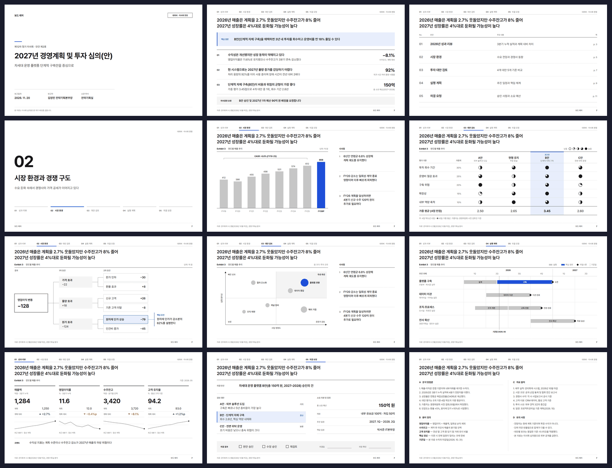
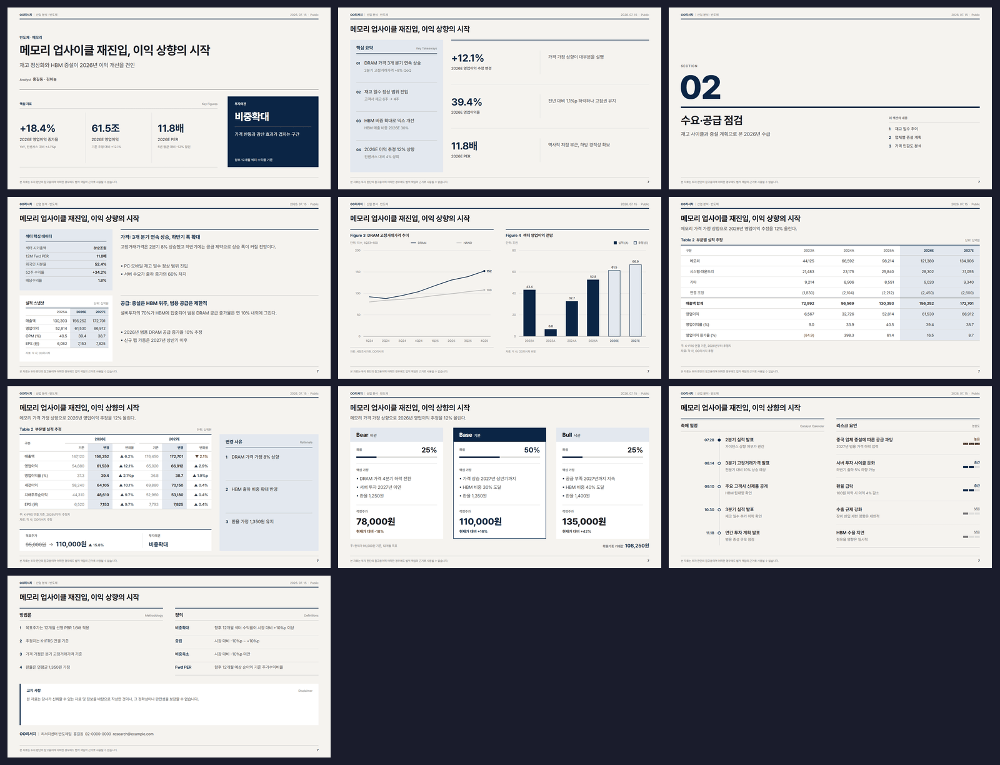
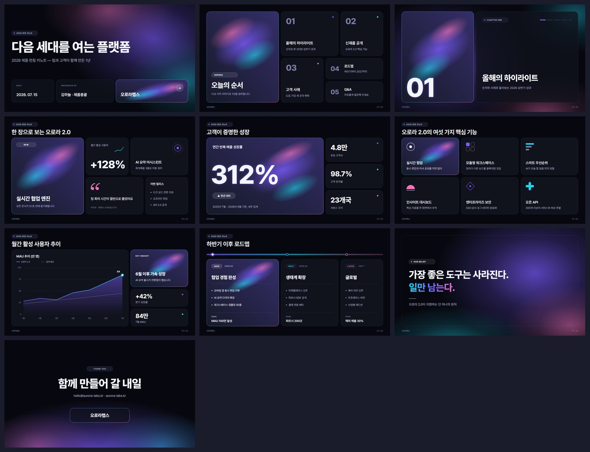
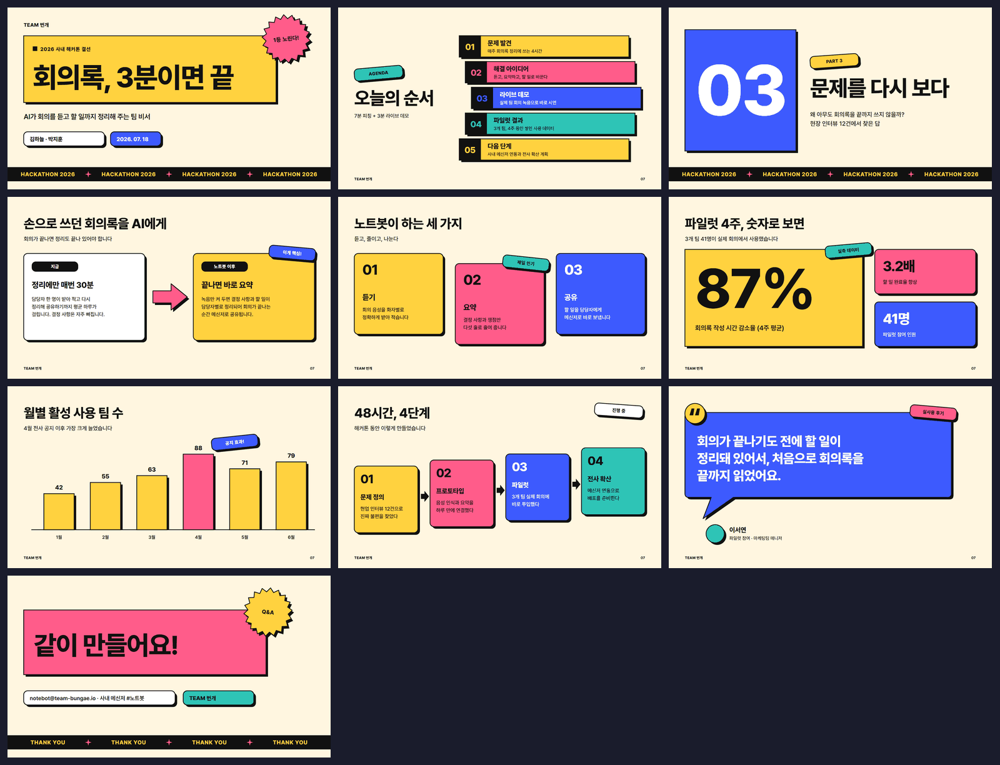
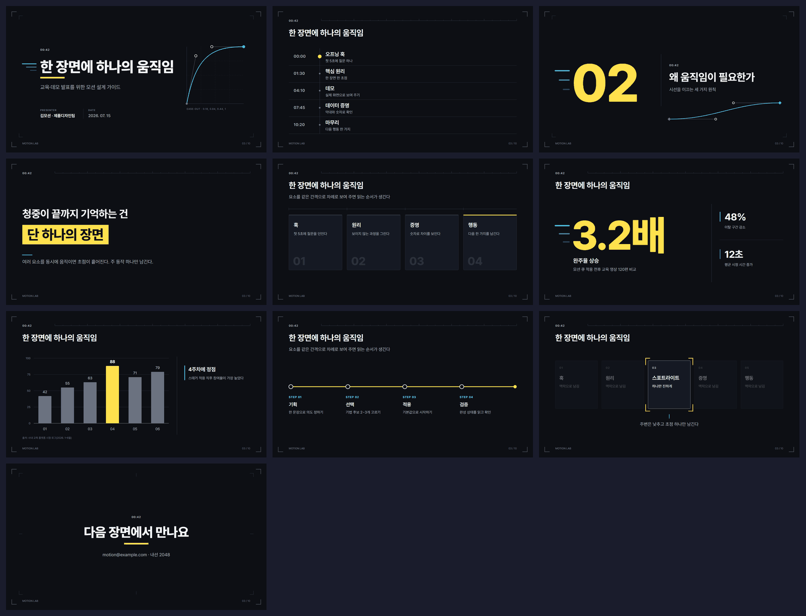
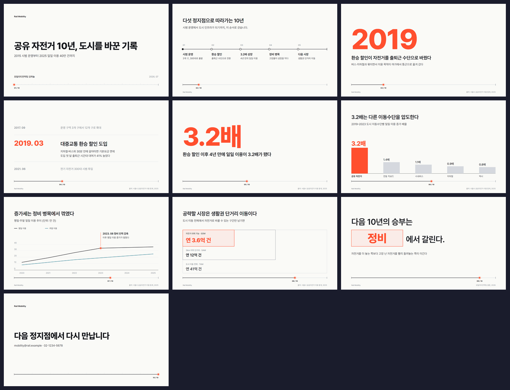
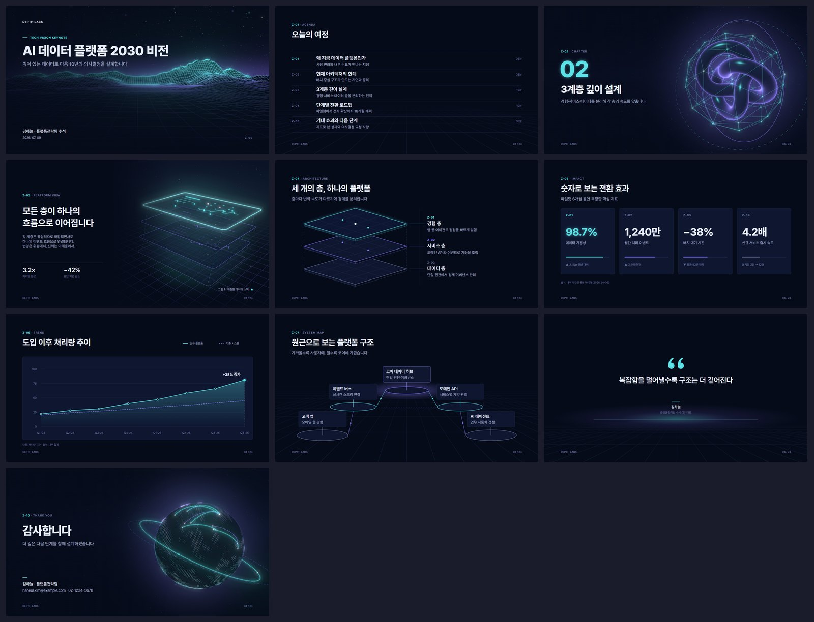

# Gallery

Every page of every template, plus the identity each one locks.

Contact sheets are rendered from the template's own review PPTX — what you see is the compiled PowerPoint, not the source SVG.

---

## Midnight Panel

`midnight-panel` · primary `#5E6AD2` · 10 pages

| | |
|---|---|
| **Theme** | Dark only — `#010102` 캔버스 고정 |
| **Tone** | 절제, 정밀, 야간 작업실 — 화면이 스스로 빛나되 과시하지 않는다 |
| **Use cases** | 제품 로드맵, 스프린트/분기 리뷰, 엔지니어링 브리핑, 개발자 컨퍼런스 세션, 내부 기술 제안 |
| **Anchors** | [dark, product, engineering, restrained, panel] |

**Signature**

1. **서피스 계단** — 그림자 없이 `#010102` → `#0f1011` → `#141516`로 올려 깊이를 만든다. 카드는 항상 1px `#23252a` 헤어라인을 두른다
2. **단일 라벤더 신호** — `#5e6ad2`는 페이지당 정확히 1곳. 표지 악센트 바, 아젠다 현재 항목, 피크 바, 시그니처 패널의 활성 요소 중 하나만
3. **제품 패널 프레임** — 16px 라운드 + 헤어라인 경계의 surface-1 패널 안에 추상 UI(타이틀바 도트 3개, 사이드바 열, 행 스켈레톤)를 그린다. **실제 제품 스크린샷이 아니라 기하 추상**이다

**Page roster**

| File | Layout key | Page Type | Purpose |
| --- | --- | --- | --- |
| `01_cover.svg` | `01_cover` | Cover | 표지 — 악센트 바 + 88px 헤드라인 + 서브카피 |
| `02_agenda.svg` | `02_agenda` | Agenda | 목차 — 헤어라인 5행, 번호·제목·태그 |
| `03_section.svg` | `03_section` | Section | 챕터 전환 — 거의 빈 캔버스 + 72px 헤드라인 |
| `04_panel_showcase.svg` | `04_panel_showcase` | **Signature** | 제품 패널 쇼케이스 — surface-1 프레임 + 추상 UI 크롬 |
| `05_two_column.svg` | `05_two_column` | Content | 좌 텍스트 / 우 패널 2단 |
| `06_card_grid.svg` | `06_card_grid` | Content | 3-up 카드 그리드 |
| `07_metrics.svg` | `07_metrics` | Stat | 3-up 지표 밴드 + 세로 헤어라인 |
| `08_chart_bar.svg` | `chart_linear` | Chart | 6-바 추이 + 피크 1개 악센트 |
| `09_chart_line.svg` | `chart_linear` | Chart | 2계열 추이 (실선/점선) |
| `10_closing.svg` | `10_closing` | Closing | 대형 브랜드 마크 + 클로징 카피 |

Full specification: [`decks/midnight-panel/templates/design_spec.md`](../.claude/skills/ppt-master/templates/decks/midnight-panel/templates/design_spec.md) · identity-only preset: [`brands/midnight-panel/`](../.claude/skills/ppt-master/templates/brands/midnight-panel/)

---

## Polarity Mono

`polarity` · primary `#171717` · 10 pages

| | |
|---|---|
| **Theme** | **Dual — 극성 반전.** 콘텐츠는 라이트(`#fafafa`), 챕터·시그니처·클로징은 다크(`#171717`) |
| **Tone** | 명료, 기술적, 자신감 — 설명하지 않고 보여준다 |
| **Use cases** | 기술 발표, 데모데이, 개발자 컨퍼런스 세션, 플랫폼·인프라 소개, 오픈소스 프로젝트 발표 |
| **Anchors** | [monochrome, contrast, developer, gradient-mesh, inversion] |

**Signature**

1. **극성 반전 = 챕터 신호** — `03` / `04` / `10`은 `#171717` 풀블리드. 밝음에서 어둠으로 넘어가는 것 자체가 구분선이며, 별도 장식을 넣지 않는다
2. **단일 메시 오브젝트** — 세 쌍(블루→틸 / 바이올렛→핑크 / 코럴→앰버)을 겹친 하나의 블롭 덩어리. 표지에만 등장하며 본문 페이지에는 없다
3. **2-반경 세계** — 인앱 UI 6px, 카드 8–12px, 마케팅 CTA 풀 필(100). 그 사이 값(15, 20 등)은 쓰지 않는다

**Page roster**

| File | Layout key | Surface | Purpose |
| --- | --- | --- | --- |
| `01_cover.svg` | `01_cover` | light + mesh | 표지 — 메시 그라디언트 백드롭 + 84px 헤드라인 |
| `02_agenda.svg` | `02_agenda` | light | 목차 — 헤어라인 5행 |
| `03_section.svg` | `03_section` | **dark** | 챕터 전환 — 극성 반전, 68px 헤드라인 |
| `04_polarity_flip.svg` | `04_polarity_flip` | **dark** | **시그니처** — 다크 + 터미널 목업 + 진술문 |
| `05_two_column.svg` | `05_two_column` | light | 좌 텍스트 / 우 카드 스택 |
| `06_card_grid.svg` | `06_card_grid` | light | 3-up 카드 그리드 |
| `07_metrics.svg` | `07_metrics` | light | 3-up 지표 밴드 |
| `08_chart_bar.svg` | `chart_linear` | light | 6-바 추이 + 피크 잉크 |
| `09_chart_line.svg` | `chart_linear` | light | 2계열 추이 (실선/점선) |
| `10_closing.svg` | `10_closing` | **dark** | 클로징 — 극성 반전 + 대형 마크 |

Full specification: [`decks/polarity/templates/design_spec.md`](../.claude/skills/ppt-master/templates/decks/polarity/templates/design_spec.md) · identity-only preset: [`brands/polarity/`](../.claude/skills/ppt-master/templates/brands/polarity/)

---

## Gradient Mesh Fintech

`gradient-mesh` · primary `#533AFD` · 10 pages

| | |
|---|---|
| **Theme** | Light — `#ffffff` 캔버스 + 쿨/웜 밴드 교대 |
| **Tone** | 정밀하고 낙관적 — 숫자를 다루되 차갑지 않다 |
| **Use cases** | 파트너 제안서, 핀테크 IR, 제품 이코노믹스, 가격·수수료 설명, 결제/정산 아키텍처 브리핑 |
| **Anchors** | [fintech, gradient, indigo, pill, tabular] |

**Signature**

1. **상단 메시 그라디언트** — 크림·셔벗·라벤더·인디고·루비 블롭이 상단 1/3을 채우고 아래로 캔버스 색으로 페이드된다. `01`과 `04`에만 등장
2. **풀 필 CTA** — 반경 9999의 인디고 필. 페이지당 최대 1개
3. **얇은 디스플레이** — 76px를 weight 300으로. 굵기가 아니라 크기가 위계다

**Page roster**

| File | Layout key | Surface | Purpose |
| --- | --- | --- | --- |
| `01_cover.svg` | `01_cover` | white + mesh | 표지 — 상단 1/3 메시 + 76px 얇은 헤드라인 + 인디고 필 |
| `02_agenda.svg` | `02_agenda` | white | 목차 — 헤어라인 5행 |
| `03_section.svg` | `03_section` | **navy** | 챕터 전환 — 네이비 카운터패널 |
| `04_gradient_statement.svg` | `04_gradient_statement` | white + mesh | **시그니처** — 메시 블롭 위 진술문 |
| `05_two_column.svg` | `05_two_column` | white | 좌 텍스트 / 우 카드 스택 |
| `06_card_grid.svg` | `06_card_grid` | cool | 3-up 카드 그리드 |
| `07_metrics.svg` | `07_metrics` | white | 3-up 지표 (3번째는 네이비 강조) |
| `08_chart_bar.svg` | `chart_linear` | white | 6-바 추이 + 피크 인디고 |
| `09_chart_line.svg` | `chart_linear` | white | 2계열 추이 |
| `10_closing.svg` | `10_closing` | **navy** | 클로징 — 네이비 + 대형 마크 |

Full specification: [`decks/gradient-mesh/templates/design_spec.md`](../.claude/skills/ppt-master/templates/decks/gradient-mesh/templates/design_spec.md) · identity-only preset: [`brands/gradient-mesh/`](../.claude/skills/ppt-master/templates/brands/gradient-mesh/)

---

## Warm Document

`warm-doc` · primary `#5645D4` · 10 pages

| | |
|---|---|
| **Theme** | Light (웜 뉴트럴) — `#ffffff` 캔버스 + `#f6f5f4` 서피스, 히어로만 네이비 |
| **Tone** | 친근하고 정돈됨 — 읽는 문서에 가까운 슬라이드 |
| **Use cases** | 사내 문서·핸드북, 신입 온보딩, 팀 위키 발표, 프로세스·정책 안내, 워크숍 자료 |
| **Anchors** | [document, warm-neutral, pastel, handbook, onboarding] |

**Signature**

1. **웜 뉴트럴 지반** — 본문 `#37352f`, 서피스 `#f6f5f4`, 경계 `#e5e3df`. 쿨그레이를 한 번도 쓰지 않는다
2. **1px 아웃라인 문법** — 모든 카드·패널·표가 헤어라인을 두른다. 그림자는 시스템 전체에 없다
3. **파스텔 틴트 5색 스택** — 시그니처 페이지에서 피치·로즈·민트·라벤더·스카이 카드가 계단식으로 겹친다. 정보 분류가 아니라 **리듬**이다

**Page roster**

| File | Layout key | Surface | Purpose |
| --- | --- | --- | --- |
| `01_cover.svg` | `01_cover` | **navy** | 표지 — 네이비 히어로 밴드 + 72px 헤드라인 |
| `02_agenda.svg` | `02_agenda` | white | 목차 — 헤어라인 5행 |
| `03_section.svg` | `03_section` | **navy** | 챕터 전환 |
| `04_tinted_cards.svg` | `04_tinted_cards` | surface | **시그니처** — 파스텔 틴트 5색 카드 스택 |
| `05_two_column.svg` | `05_two_column` | white | 좌 텍스트 / 우 아웃라인 스택 |
| `06_card_grid.svg` | `06_card_grid` | surface | 3-up 카드 그리드 (흰 카드 + 헤어라인) |
| `07_metrics.svg` | `07_metrics` | white | 3-up 지표 |
| `08_chart_bar.svg` | `chart_linear` | white | 6-바 추이 + 피크 퍼플 |
| `09_chart_line.svg` | `chart_linear` | white | 2계열 추이 |
| `10_closing.svg` | `10_closing` | **navy** | 클로징 |

Full specification: [`decks/warm-doc/templates/design_spec.md`](../.claude/skills/ppt-master/templates/decks/warm-doc/templates/design_spec.md) · identity-only preset: [`brands/warm-doc/`](../.claude/skills/ppt-master/templates/brands/warm-doc/)

---

## Open Road

`open-road` · primary `#3E6AE1` · 10 pages

| | |
|---|---|
| **Theme** | Light + 카본 다크 구분면 — `#FFFFFF` 본문, `#171A20` 챕터·클로징 |
| **Tone** | 확신에 차고 조용함 — 갤러리처럼 한 번에 하나만 보여준다 |
| **Use cases** | 제품 런칭, 브랜드 키노트, 비전 발표, 쇼룸·전시 프레젠테이션, 신사업 소개 |
| **Anchors** | [cinematic, photography, keynote, gallery, launch] |

**Signature**

1. **한 페이지 한 메시지** — 시그니처 페이지(`04`)는 사진 한 장과 문장 하나뿐이다. 불릿·카드·아이콘을 얹지 않는다
2. **풀블리드 사진 = 페이지 자체** — `01`/`04`는 사진이 캔버스 가장자리까지 닿는다. 라운딩 0, 프레임 없음
3. **각진 지오메트리** — 기본 반경 0. 버튼 4, 카테고리 카드 12. 그 사이 값은 쓰지 않는다

**Page roster**

| File | Layout key | Surface | Purpose |
| --- | --- | --- | --- |
| `01_cover.svg` | `01_cover` | **photo** | 표지 — 풀블리드 사진 + 하단 좌측 타이틀 스택 |
| `02_agenda.svg` | `02_agenda` | white | 목차 — 구분선 5행 |
| `03_section.svg` | `03_section` | **carbon** | 챕터 전환 — 카본 다크 |
| `04_fullbleed_hero.svg` | `04_fullbleed_hero` | **photo** | **시그니처** — 풀블리드 사진 + 중앙 한 문장 |
| `05_two_column.svg` | `05_two_column` | white | 좌 텍스트 / 우 이미지 블록 |
| `06_card_grid.svg` | `06_card_grid` | white | 3-up 카드 그리드 |
| `07_metrics.svg` | `07_metrics` | white | 3-up 지표 밴드 |
| `08_chart_bar.svg` | `chart_linear` | white | 6-바 추이 + 피크 일렉트릭 |
| `09_chart_line.svg` | `chart_linear` | white | 2계열 추이 |
| `10_closing.svg` | `10_closing` | **carbon** | 클로징 — 카본 다크 |

Full specification: [`decks/open-road/templates/design_spec.md`](../.claude/skills/ppt-master/templates/decks/open-road/templates/design_spec.md) · identity-only preset: [`brands/open-road/`](../.claude/skills/ppt-master/templates/brands/open-road/)

---

## Signal Green

`signal-green` · primary `#76B900` · 10 pages

| | |
|---|---|
| **Theme** | **Dual** — 히어로·챕터·클로징은 `#000000`, 콘텐츠·데이터는 `#FFFFFF` |
| **Tone** | 단호하고 기술적 — 성능 수치가 주인공이다 |
| **Use cases** | AI·GPU·인프라 브리핑, 개발자 세션, 기술 컨퍼런스 발표, 벤치마크·성능 리포트, 플랫폼 로드맵 |
| **Anchors** | [tech-keynote, angular, signal-accent, benchmark, dual-theme] |

**Signature**

1. **12×12px 그린 코너 스퀘어** — 카드·패널의 좌상단에 놓이는 이 시스템의 서명. 아이콘도 불릿도 아닌 **위치 표식**이다
2. **극성 교대** — 블랙(`01`/`03`/`04`/`10`)과 화이트(`02`/`05`–`09`)가 번갈아 나온다. 어두움이 챕터를 연다
3. **앵귤러 2px** — 카드·버튼·바는 반경 **2px**. 히어로·푸터·풀블리드는 0. 그 사이 값은 쓰지 않는다

**Page roster**

| File | Layout key | Surface | Purpose |
| --- | --- | --- | --- |
| `01_cover.svg` | `01_cover` | **black** | 표지 — 블랙 + 72px 볼드 + 그린 규칙선 |
| `02_agenda.svg` | `02_agenda` | white | 목차 — 헤어라인 5행 |
| `03_section.svg` | `03_section` | **black** | 챕터 전환 — 극성 반전 |
| `04_black_hero.svg` | `04_black_hero` | **black** | **시그니처** — 12×12 그린 코너 스퀘어 + 진술문 |
| `05_two_column.svg` | `05_two_column` | white | 좌 텍스트 / 우 패널 스택 |
| `06_card_grid.svg` | `06_card_grid` | white | **4-up** 카드 그리드 (코너 스퀘어 장식) |
| `07_metrics.svg` | `07_metrics` | white | 3-up 지표 밴드 |
| `08_chart_bar.svg` | `chart_linear` | white | 6-바 추이 + 피크 그린 |
| `09_chart_line.svg` | `chart_linear` | white | 2계열 추이 |
| `10_closing.svg` | `10_closing` | **black** | 클로징 — 극성 반전 |

Full specification: [`decks/signal-green/templates/design_spec.md`](../.claude/skills/ppt-master/templates/decks/signal-green/templates/design_spec.md) · identity-only preset: [`brands/signal-green/`](../.claude/skills/ppt-master/templates/brands/signal-green/)

---

## Koscom Chevron

`koscom-chevron` · primary `#EE6D1D` · 10 pages · corporate house template (KoPub돋움체)

| | |
|---|---|
| **Theme** | Light body + **navy** anchors (`#00338D`) + **black** signature — the three surfaces of Koscom's official Orange / Blue / Black samples in one spine |
| **Tone** | 단정하고 명확한 공기업형 코퍼레이트 — 굵은 KoPub 헤드라인, 넉넉한 여백, 한 방향(›)으로 밀어주는 셰브론 |
| **Use cases** | 회사소개서, 사업 브리핑, 경영 보고, 대외 제안서, 채용 설명회 — 코스콤 및 자본시장 IT 문맥 |
| **Anchors** | [koscom, chevron, orange, navy, corporate, capital-market, kopub] |

**Signature**

1. **셰브론(›) 모티프** — 하우스 마크의 꺾쇠를 565×760 다각형으로 옮겼다. 표지 3겹(grey → pale → orange-deep), 챕터 3겹(navy-mid → navy-soft → orange-deep), 클로징 2겹. 항상 오른쪽을 가리키고 캔버스 밖으로 잘려 나가며 **본문 페이지에는 오르지 않는다**
2. **키커 바 + 굵은 KoPub 헤드라인** — 8×26 오렌지 세로 바 뒤에 대문자 키커(자간 +4), 그 아래 Bold 헤드라인. 위계는 크기 램프(128 / 52 / 48 / 30)로 만든다
3. **웨이브 필드** — 시그니처 페이지의 블랙 위에 1px 오렌지 사인 곡선 14줄을 세 톤으로 층지어 깊이를 만든다. 래스터가 아니라 패스다
4. **번호 원** — r=12 오렌지 원 + 흰 숫자. 목록·카드·다이어그램의 순서는 불릿 대신 이것으로

**Page roster**

| File | Layout key | Surface | Purpose |
| --- | --- | --- | --- |
| `01_cover.svg` | `01_cover` | white + chevrons | 표지 — 브랜드 마크, 키커 바, 52px 헤드라인, 셰브론 3겹 |
| `02_agenda.svg` | `02_agenda` | white | 목차 — 좌 제목 블록 / 우 5행(44px 오렌지 번호) |
| `03_section.svg` | `03_section` | **navy** | 챕터 — 128px 번호 + `CHAPTER` + 제목, 셰브론 3겹 |
| `04_wave_statement.svg` | `04_wave_statement` | **black** | **시그니처** — 웨이브 필드 + 56px 진술문 |
| `05_two_column.svg` | `05_two_column` | white | 좌 본문 + 번호 포인트 / 우 번호 카드 |
| `06_card_grid.svg` | `06_card_grid` | white | 3-up 카드 — 오렌지 틴트 헤더 밴드 |
| `07_metrics.svg` | `07_metrics` | white | 3-up 지표 — 3번째 패널 오렌지 |
| `08_chart_bar.svg` | `chart_linear` | white | 6-바 추이, 각진 바, 피크 오렌지 |
| `09_chart_line.svg` | `chart_linear` | white | 2계열 추이 — 오렌지 실선 + 그레이 점선 |
| `10_closing.svg` | `10_closing` | **navy** | 클로징 — 60px 브랜드 마크 + 셰브론 |

Full specification: [`decks/koscom-chevron/templates/design_spec.md`](../.claude/skills/ppt-master/templates/decks/koscom-chevron/templates/design_spec.md) · identity-only preset: [`brands/koscom-chevron/`](../.claude/skills/ppt-master/templates/brands/koscom-chevron/) · fonts: [`decks/koscom-chevron/fonts/FONTS.md`](../.claude/skills/ppt-master/templates/decks/koscom-chevron/fonts/FONTS.md)
---

## 2026-11 추가 7종

아래 7종의 컨택트 시트는 실제 길이의 가상 예시 문구를 채운 SVG 렌더입니다(토큰 원문으로는 큰 숫자 칸이 넘쳐 보이기 때문). 같은 쪽을 확인용 PPTX로 컴파일해 PowerPoint로 72장 모두 렌더해 확인했습니다.

## Board Ledger

`board-ledger` · primary `#1E4FD8` · 12 pages

| | |
|---|---|
| **Theme** | **Light** — 전 페이지 `#FFFFFF`, 패널은 별도 재질인 영역에만 |
| **Tone** | 절제·정밀·근거 우선 — **제목만 읽어도 결론이 이어진다** |
| **Use cases** | 이사회·경영위원회 보고, 경영계획·투자 심의, 전략 검토 보고, 분기 성과 리뷰 |
| **Anchors** | [board-report, action-title, exhibit, tracker, dense] |

**Signature**

1. **5단 트래커** — 탭마다 `0n` + 장 이름(`{{TRACK_n}}`), 현재 장만 잉크 SemiBold + 블루 128×3 언더라인이 헤더 규칙선 위에 얹힌다. 요약·목차·부록은 현재 장이 없으므로 언더라인도 없다. 간지에서는 같은 5단이 하단 4px 위치 스트립으로 나타난다
2. **고정 액션 타이틀 존** — 28px SemiBold 완결 문장, 최대 2줄. 라벨형 제목("매출 현황")과 질문형 제목은 쓰지 않는다
3. **Exhibit 라인** — `Exhibit n · 제목`(좌) ↔ `단위: …` 또는 범례(우), 그 아래 잉크 1px. 모든 숫자에 단위·기준이 붙는다

**Page roster**

| File | Layout key | Picker name | Master | Purpose |
| --- | --- | --- | --- | --- |
| `01_cover.svg` | `ledger_cover` | Cover | `ledger_title_master` | 표지 — 백지 위 48px 제목, 48×3 블루 규칙선, 우상단 분류 스탬프, 보고일자·보고자·소관 부서 메타 |
| `02_exec_summary.svg` | `ledger_exec_summary` | Executive Summary | `ledger_content_master` | 결론 먼저 — 틴트 결론 박스, 번호 3행 근거 + 우측 핵심 수치, 하단 의사결정 요청 레일 |
| `03_agenda.svg` | `ledger_agenda` | Agenda | `ledger_content_master` | 목차 — 규칙선 5행(번호·안건·주요 내용·쪽) |
| `04_section.svg` | `ledger_section` | Section | `ledger_title_master` | 간지 — 104px 장 번호, 장 제목·설명, 하단 5단 위치 스트립 |
| `05_exhibit_chart.svg` | `ledger_exhibit_rail` | Exhibit + Takeaway Rail | `ledger_content_master` | 8개 막대(초점 1개 블루), 직접 값 라벨, CAGR 브래킷 + 시사점 레일 3항 |
| `06_exhibit_table.svg` | `ledger_exhibit_full` | Exhibit — Full Width | `ledger_content_master` | 4개 대안 × 5개 기준, 하비볼 0–4, 가중치 열, 합계 행, 권고안 열 틴트 |
| `07_issue_tree.svg` | `ledger_exhibit_full` | Exhibit — Full Width | `ledger_content_master` | MECE 트리 — 결과 1 → 1차 동인 3 → 2차 동인 6, 직각 연결선, 핵심 동인 콜아웃 |
| `08_matrix_2x2.svg` | `ledger_exhibit_rail` | Exhibit + Takeaway Rail | `ledger_content_master` | 2×2 우선순위 — 화살표 축, 사분면 라벨, 크기 버블 6개(초점 1개) + 시사점 레일 |
| `09_roadmap.svg` | `ledger_exhibit_full` | Exhibit — Full Width | `ledger_content_master` | 분기 간트 — 6분기, 4개 과제, 핵심 경로 막대, 마일스톤 다이아몬드, 기준일 점선 |
| `10_kpi_scorecard.svg` | `ledger_kpi` | KPI Scorecard | `ledger_content_master` | 지표 4개 — 실적·계획·차이(상태색)·8분기 스파크라인, 코멘트 행 |
| `11_decision.svg` | `ledger_decision` | Decision Request | `ledger_content_master` | 의결 요청(엔딩) — 의결 안건, 검토 대안 vs 권고, 소요 자원·일정·책임, 승인란 |
| `12_appendix.svg` | `ledger_appendix` | Appendix — Two Column | `ledger_content_master` | 부록 — 단일 세로 규칙선 위 2단 노트(방법론·용어·출처·유의 사항), 패널 없음 |

Full specification: [`decks/board-ledger/templates/design_spec.md`](../.claude/skills/ppt-master/templates/decks/board-ledger/templates/design_spec.md)

---

## Research Note

`research-note` · primary `#0B2545` · 10 pages

| | |
|---|---|
| **Theme** | **Light paper** — 전 페이지 `#F5F3EF` 종이 바탕, 표·패널만 `#FFFFFF` |
| **Tone** | 밀도·정확·인용 가능 — 모든 수치에 단위·기간·출처가 붙는다 |
| **Use cases** | 금융·산업 리서치 브리핑, 시장 동향 보고, 투자 검토 요약, 분기 실적 분석, 추정치 변경 노트 |
| **Anchors** | [research-report, dense-table, figure-source, sidebar, finance] |

**Signature**

1. **헤더 줄 + 3px 네이비 상단 규칙선** — 모든 페이지 맨 위. 좌측 `{{BRAND_MARK}}`(네이비 700) `|` `{{REPORT_TYPE}}`, 우측 `{{DATE}} · {{CLASSIFICATION}}`. 이 한 줄이 덱을 "발간물"로 만든다
2. **규칙선 굵기 사다리** — 페이지 3px 네이비 → 단·그림·표 상단 2px 네이비 → 섹션 구분 1px `#B8B8B8` → 행 구분 1px `#DCDCDC`. 박스 테두리 대신 선의 굵기로 위계를 만든다
3. **Figure / 자료 쌍** — 그림·표마다 `Figure n` / `Table n`(네이비 600) + 제목(잉크 600), `단위:` 줄, 그리고 반드시 아래쪽 `#B8B8B8` 선 뒤에 `자료:` 줄. 출처 없는 그림은 이 템플릿에 없다

**Page roster**

| File | Layout key | Layout name | Purpose |
| --- | --- | --- | --- |
| `01_cover.svg` | `rn_cover` | Cover (Key Call) | 표지 — 섹터 키커, 48px 제목·부제, 애널리스트, 핵심 지표 3개 줄 + 네이비 투자의견 박스 |
| `02_key_takeaways.svg` | `rn_takeaways` | Key Takeaways (Sidebar) | 핵심 요약 — 틴트 사이드바(4개 요점 + 근거 줄) + 우측 핵심 수치 3행(수치·라벨·코멘트) |
| `03_section.svg` | `rn_section` | Section Divider | 섹션 전환 — 132px 네이비 번호, 6px 네이비 규칙선, 제목·설명, 섹션 내용 3항목 |
| `04_sidebar_analysis.svg` | `rn_sidebar` | Sidebar + Main Column | 분석 본문 — 팩트 박스(5행) + 데이터 스냅샷 표 / 본문 2개 소제목·문단·요점 |
| `05_figure_chart.svg` | `rn_figure_pair` | Figure Pair | 그림 2개 — Figure n 라인 차트(2계열) + Figure n 막대 차트(실적/추정), 각자 단위·자료 줄 |
| `06_data_table.svg` | `rn_table` | Financial Table | 재무 표 — 8행 × 6열, 추정 열 틴트, 합계 행 굵게, 주·자료 줄 |
| `07_estimate_revision.svg` | `rn_revision` | Estimate Revision | 추정 변경 — 기존/변경/변화율 표(▲▼), 목표주가·투자의견 띠, 변경 사유 박스 |
| `08_scenario.svg` | `rn_scenario` | Scenario (Bear / Base / Bull) | 시나리오 — 3단, 확률 막대·핵심 가정 3줄·결과값, Base 단 네이비 강조, 확률가중 기대값 |
| `09_catalyst_risk.svg` | `rn_catalyst_risk` | Catalyst Calendar + Risk | 촉매 일정 타임라인(5개) + 리스크 목록(3단계 영향도 미터) |
| `10_disclosure.svg` | `rn_disclosure` | Disclosure (Ending) | 마지막 장 — 방법론·용어 정의, 고지 사항 블록, 연락처 줄 |

Full specification: [`decks/research-note/templates/design_spec.md`](../.claude/skills/ppt-master/templates/decks/research-note/templates/design_spec.md)

---

## Bento Aurora

`bento-aurora` · primary `#7C5CFF` · 10 pages

| | |
|---|---|
| **Theme** | Dark only — `#07080F` 캔버스 고정 |
| **Tone** | 몰입·프리미엄·에너지 — 어두운 무대 위에서 한 칸만 빛난다 |
| **Use cases** | 제품·서비스 런칭, 해커톤 데모데이, 연간 성과 하이라이트, 비전 키노트 |
| **Anchors** | [bento, aurora, dark, keynote, launch] |

**Signature**

1. **히어로 타일 1칸** — `#161A29` 바탕 → 보라 워시(대각선 linear, 0.3 → 0) → 회전된 보라·핑크·시안 radial 타원 3개(중심 0.66–0.8 → 45% 0.34–0.46 → 0) → 보라→시안→핑크 그라디언트 테두리 1.5px. 타원은 타일 경계 안에 들어가도록 배치하고(클립 없음), 같은 각도(-12° ~ -30°)로 기울여 리본처럼 겹친다. **크고 밝은 칸 = 이 페이지에서 가장 중요한 말**
2. **12열 벤토 리듬** — 스팬이 서로 다른 타일(3·4·5·8열 / 116·160·248·512 높이)을 16px 간격으로 맞물린다. 같은 크기 타일만 반복하지 않는다(06의 3×2만 예외, 대신 히어로 1칸으로 깬다)
3. **스퀴클 코너 rx 24** — 모든 타일은 24, 칩은 h/2(28→14, 32→16), 진행 바·스와치는 높이/2

**Page roster**

| File | Layout key | Layout name | Purpose |
| --- | --- | --- | --- |
| `01_cover.svg` | `01_cover` | Cover (Aurora Field) | 표지 — 우상단 오로라 필드 + 88px 제목 + 하단 3칸 메타 벤토(날짜·발표자·브랜드 히어로) |
| `02_agenda.svg` | `02_agenda` | Agenda (Bento) | 목차 — 좌측 세로 히어로(제목) + 크기가 다른 5개 항목 타일(01–05) |
| `03_section.svg` | `03_section` | Section (Aurora Numeral) | 챕터 — 배경 필드 + 히어로 타일 속 180px 글로우 숫자 + 우측 제목 타일과 진행 바 |
| `04_bento_overview.svg` | `04_bento_overview` | Bento Overview | **시그니처** — 세로 히어로 + 지표·글리프·인용·리스트 4칸 핀휠 |
| `05_hero_metric.svg` | `05_hero_metric` | Hero Metric | 8열 히어로 속 176px 거대 지표 + 델타 칩 + 우측 3단 보조 지표 |
| `06_feature_grid.svg` | `06_feature_grid` | Feature Grid (3x2) | 3×2 기능 타일, 첫 칸이 히어로. 기본 도형 글리프 + 제목 + 1행 설명 |
| `07_chart.svg` | `07_chart` | Chart + Insight | 8열 영역형 라인 차트 타일 + 인사이트 히어로 + 보조 지표 2칸 |
| `08_roadmap.svg` | `08_roadmap` | Roadmap (Now Next Later) | 오로라 레일 + 마일스톤 점 + 폭이 줄어드는 NOW(5열)·NEXT(4열)·LATER(3열) 타일 |
| `09_statement.svg` | `09_statement` | Statement (Aurora) | 풀블리드 오로라 필드 + 전폭 헤어라인 프레임 + 2행 진술문(2행째 그라디언트 강조) |
| `10_closing.svg` | `10_closing` | Closing (Aurora Horizon) | 하단에서 떠오르는 오로라 수평선 + 가운데 클로징 카피 + 브랜드 히어로 타일 |

Full specification: [`decks/bento-aurora/templates/design_spec.md`](../.claude/skills/ppt-master/templates/decks/bento-aurora/templates/design_spec.md)

---

## Pop Brutal

`pop-brutal` · primary `#FFD23F` · 10 pages

| | |
|---|---|
| **Theme** | **Light** — 크림 `#FFF6E0` 단일 마스터. 다크 페이지 없음 (마퀴 띠만 잉크) |
| **Tone** | 경쾌·대담·직설 — 한 장에 한 메시지를 크게 외친다 |
| **Use cases** | 해커톤 피칭·데모데이, 사내 캠페인·이벤트, 워크숍 오프닝, 공모전 발표 |
| **Anchors** | [neo-brutalism, pop, hackathon, bold, sticker] |

**Signature**

1. **외곽선 + 하드 그림자 블록** — 모든 블록은 ① 같은 크기의 잉크 사각형을 (+8, +8) 밀어 먼저 깔고 ② 그 위에 채움 + 3px 잉크 외곽선을 얹는다. `filter`를 쓰지 않으므로 PPTX에서 그대로 편집 가능한 도형 2개가 된다. 그림자 방향은 덱 전체에서 오른쪽 아래 하나뿐이다.
2. **모서리는 0 아니면 16** — 히어로 블록·아젠다 바·섹션 번호 블록·차트 막대·마퀴 띠는 `rx=0`. 카드·스텝·문제/해결 블록·칩·스티커 태그·말풍선은 `rx=16`. 그 사이 값은 없다.
3. **스티커 1장/페이지** — 높이 48 · `rx=16` 태그(18px 800, 중앙 정렬) 또는 18각 스타버스트(외경 96·내경 80, 표지·클로징 전용). 그룹 단위 `rotate(-6…+6, cx, cy)`로만 기울인다. 붙이는 자리: 히어로 블록의 오른쪽 위 모서리에 반쯤 걸치거나(`01`·`04`·`05`·`06`·`09`·`10`), 걸칠 블록이 없으면 헤더 오른쪽(`08`)·제목 위(`02`·`03`)·강조 막대 옆(`07`). 스티커 문구는 2–8자 감탄형("1등 노린다!", "Q&A").

**Page roster**

| File | Layout key | Picker name | Layout 고정 원자 | Purpose |
| --- | --- | --- | --- | --- |
| `01_cover.svg` | `01_cover` | Cover | 마퀴 띠, 노랑 제목 블록+그림자 | 표지 — 112px 제목 블록, 핑크 스타버스트, 발표자·날짜 칩, 마퀴 |
| `02_agenda.svg` | `02_agenda` | Agenda Stack | — (좌측 제목 슬롯 경계로 구분) | 아젠다 — 좌측 72px 제목 + 우측 5단 바, 지그재그 오프셋 0/24/48/24/0 |
| `03_section.svg` | `03_section` | Section Numeral | 마퀴 띠 | 챕터 전환 — 280px 번호 블록(챕터 색), 88px 제목, 마퀴 |
| `04_problem_solution.svg` | `04_problem_solution` | Problem to Solution | 문제 블록·해결 블록·핑크 화살표 (각 그림자 포함 6개) | 문제 → 해결 대비 |
| `05_card_trio.svg` | `05_card_trio` | Card Trio | — | 3장 카드, 가운데 카드만 40px 내려 엇갈림 |
| `06_big_number.svg` | `06_big_number` | Big Number | 노랑 지표 블록+그림자 | 220px 지표 1개 + 미니 블록 2개 |
| `07_chart.svg` | `07_chart` | Chart (Bars) | 3px 잉크 베이스라인 | 외곽선 막대 차트 (샘플 데이터) |
| `08_steps.svg` | `08_steps` | Steps | 잉크 화살표 3개 | 4단계 — 24px씩 올라가는 계단 블록 |
| `09_quote.svg` | `09_quote` | Quote Bubble | 블루 말풍선+그림자 | 인용 — 꼬리 달린 말풍선, 노랑 따옴표 배지, 아바타 점 |
| `10_closing.svg` | `10_closing` | Closing | 마퀴 띠, 핑크 클로징 블록+그림자 | 클로징 — 104px 한 줄, 노랑 스타버스트, 연락처·브랜드 칩, 마퀴 |

Full specification: [`decks/pop-brutal/templates/design_spec.md`](../.claude/skills/ppt-master/templates/decks/pop-brutal/templates/design_spec.md)

---

## Motion Cue

`motion-cue` · primary `#FFE14D` · 10 pages

| | |
|---|---|
| **Theme** | **Dark** 단일 — 전 페이지 `#0D0F14` |
| **Tone** | 리듬감·명료·한 장면 한 초점 — 움직임은 읽는 순서를 만들 때만 쓴다 |
| **Use cases** | 교육·설명 발표, 제품 데모, 해커톤 피칭, 사내 교육 오프닝, 영상 녹화용 발표 |
| **Anchors** | [motion, kinetic, timecode, animation-map, video-ready] |

**Signature**

1. **비디오 프레임 가이드** — 마스터의 크롭 마크(`#6B7280`, 인셋 28)와 앵커 페이지의 세이프 브래킷(`#2A2F3A`, 64/48). 클로징은 프레임 중앙 마크를 더한다
2. **타임코드 키커 + 눈금자** — 모든 페이지에 `{{TIMECODE}}`(예: `00:12`, `01:30`). 콘텐츠 페이지는 눈금자(40px 간격, 160px마다 긴 눈금)가 헤더를 이룬다. 타임코드는 발표 흐름상 위치이며, 녹화용이면 실제 영상 시점과 맞춘다
3. **이징 커브 오너먼트** — 표지는 그래프 에디터형 ease-out 커브(`0.16, 0.84, 0.44, 1`)와 핸들 점, 섹션은 키프레임 다이아몬드가 달린 ease-in-out 모션 패스. 커브 수치를 바꾸면 라벨도 함께 바꾼다

**Page roster**

| File | Layout key | Picker name | 고정 Layout 원자 | 슬롯 | Purpose |
| --- | --- | --- | --- | --- | --- |
| `01_cover.svg` | `01_cover` | Cover (Kinetic Title) | 세이프 브래킷, 이징 그리드·축·라벨 | slide-number | 표지 — 키네틱 제목 + 이징 커브 + 노란 밑줄 큐 |
| `02_agenda.svg` | `02_agenda` | Agenda (Timecoded) | 눈금자, 목차 레일 | title, slide-number | 타임코드 목차 5행 + 노란 플레이헤드 |
| `03_section.svg` | `03_section` | Section (Push-in Number) | 세이프 브래킷, 세로 구분선 | title, slide-number | 장 전환 — 거대 노란 숫자 + 스피드 라인 + ease-in-out 모션 패스 |
| `04_word_emphasis.svg` | `04_word_emphasis` | Word Emphasis (Highlight Sweep) | 눈금자 | title(진술문), slide-number | 진술문 + 노란 하이라이트 띠 위 강조어 |
| `05_stagger_cards.svg` | `05_stagger_cards` | Stagger Cards (4-up) | 눈금자, 스태거 틱 라인 | title, body(리드), slide-number | 4카드 순차 등장, 마지막 카드만 노란 바 |
| `06_count_up.svg` | `06_count_up` | Count-up KPI | 눈금자, KPI 구분선 | title, slide-number | 거대 KPI 1 + 보조 지표 2 |
| `07_bar_grow.svg` | `07_bar_grow` | Bar Grow Chart | 눈금자, 테이크어웨이 구분선 | title, slide-number | 6막대 + 노란 피크 + 테이크어웨이 |
| `08_line_draw.svg` | `08_line_draw` | Line Draw Process | 눈금자, 트랙 가이드 | title, body(리드), slide-number | 노란 트랙이 그려지는 4단계 프로세스 |
| `09_spotlight.svg` | `09_spotlight` | Spotlight (Focus + Context) | 눈금자 | title, slide-number | 흐린 맥락 4 + 노란 포커스 브래킷 1 |
| `10_closing.svg` | `10_closing` | Closing (End Card) | 세이프 브래킷, 중앙 마크 | slide-number | 중앙 정렬 엔드 카드 + 노란 밑줄 큐 |

Full specification: [`decks/motion-cue/templates/design_spec.md`](../.claude/skills/ppt-master/templates/decks/motion-cue/templates/design_spec.md)

---

## Scroll Rail

`scroll-rail` · primary `#FF4F2E` · 10 pages

| | |
|---|---|
| **Theme** | Light paper (`#FAFAF7`) 단일 극성 + 먹 + 주홍 한 점 |
| **Tone** | 이어지는 서사 — 한 정지점에 한 주장. 넘기는 것이 아니라 레일을 따라 걷는다 |
| **Use cases** | 연혁·로드맵 발표, 데이터 스토리, 신제품 공개, 진단(전체→원인) 브리핑, 키노트 선언 |
| **Anchors** | [scroll-story, progress-rail, handoff, timeline, narrative] |

**Signature**

1. **하단 진행 레일** — Master에 고정된 2px 레일. 페이지는 넘어가도 레일은 그대로이고, 마커만 공식대로 전진한다. 지나온 구간은 먹색 진행선으로 칠한다
2. **정지 마커** — 주홍 점 + 16% 헤일로 + `03 / 10` 라벨. 07의 데이터 핀도 같은 모양이다: "정지점"은 덱 전체에서 한 가지 기호다
3. **앵커 라인 A (80, 352)** — 표지 제목, 여정 레일, 연도, 날짜, 숫자, 첫 막대 라벨, 부분 값, 단어, 클로징 라인이 모두 이 baseline에 앉는다. 시선이 한 높이에 머물고 내용만 바뀐다 — 원작의 "무대 1개"

**Page roster**

| File | Layout key / picker | Scrolline 개념·move | Purpose & slots |
| --- | --- | --- | --- |
| `01_cover.svg` | `01_cover` / Cover · Rail Start | rail — 레일의 시작 | 72px 제목이 앵커 라인 A에 앉고, 레일 눈금(layout 원자) 위 마커가 x=80. title + subtitle 슬롯, 좌상단 브랜드, 발표자·날짜 행 |
| `02_overview.svg` | `02_overview` / Overview · Journey Rail | rail — 전체 여정 | 앵커 라인 A에 여정 레일(layout 원자, 먹 2px + 끝 틱)과 정지점 5개(번호·제목·한 줄 설명). 첫 정지점만 채운 원. title + body 슬롯 |
| `03_era_shift.svg` | `03_era_shift` / Era Shift | rail: era-shift | 220px 주홍 연도 + 결론 한 줄(36) + 보충. title + body 슬롯 |
| `04_event.svg` | `04_event` / Event Entry | rail: rail-advance | 연감 행: 규칙선 두 줄(layout 원자) 사이에 날짜(좌, 앵커 A) + 제목·2줄 상세(우, x=440). 위·아래에 지나간/다음 사건이 muted로 흐른다. title + body(상세) 슬롯 |
| `05_number_slam.svg` | `05_number_slam` / Number Slam | launch: number-slam | 200px 주홍 숫자 하나 + 의미 한 줄 + 출처. title 슬롯만 |
| `06_data_carry.svg` | `chart_stage` / Chart Stage | data: mark-morph · counter-handoff | 05의 숫자가 첫 막대(최댓값, 주홍)의 라벨이 되어 같은 좌표에 남는다. 나머지 4개는 회색 맥락. title + body 슬롯, plot 기준선(layout 원자) |
| `07_annotation_pin.svg` | `chart_stage` / Chart Stage | data: annotation-pin | 06과 같은 차트 무대에서 막대→선. 주 계열 먹, 보조 계열 틸, 핀 하나(주홍 점 + 리더 + 2줄 콜아웃) |
| `08_zoom_dive.svg` | `08_zoom_dive` / Zoom Dive | zoom: zoom-dive · depth-ladder | (80,256) 꼭짓점을 공유하는 3중 프레임(전체 rail → 중간 muted → 부분 주홍, layout 원자). 라벨이 왼쪽 위→아래로 부분→전체 사다리 |
| `09_kinetic_line.svg` | `09_kinetic_line` / Kinetic Line | kinetic: word-door · phrase-fold | 문장 하나가 무대. 앞 구(64) / 단어 문 안의 단어(88, 주홍) + 뒤 구(64) / 보충. 단어 문 프레임은 layout 원자 |
| `10_closing.svg` | `10_closing` / Closing · Rail End | rail — 도착 | 64px 클로징 라인(앵커 A) + 연락처, 레일 눈금, 진행선 100%·마커 x=1200 |

Full specification: [`decks/scroll-rail/templates/design_spec.md`](../.claude/skills/ppt-master/templates/decks/scroll-rail/templates/design_spec.md)

---

## Depth Field

`depth-field` · primary `#5CE1E6` · 10 pages

| | |
|---|---|
| **Theme** | **Dark** — 전 페이지 `#060B1A` 딥 네이비 |
| **Tone** | 깊이감·미래지향·정돈 — 화면 안쪽으로 공간이 열린다 |
| **Use cases** | 기술 비전·아키텍처 발표, AI·데이터 플랫폼 소개, 해커톤 데모, 미래 전략 키노트 |
| **Anchors** | [three-js, 3d-render, depth, perspective-grid, tech-keynote] |

**Signature**

1. **렌더 배경 = 3D 공간** — `01`/`03`/`10`은 풀블리드, `04`는 우측 60% 렌더. 렌더는 Layout 원자(`<image>`)이며 그 위에 `#060B1A` 스크림 원자가 있어 텍스트 대비를 보장한다
2. **원근 바닥 그리드** — 소실점(x=640)으로 모이는 선 + 원근 간격 가로선. `stroke` 세로 그라디언트로 지평선 쪽이 사라진다. `02`/`08`/`09`의 Layout 원자이며 표지 폴백에도 쓰인다
3. **깊이 라벨 `Z-NN`** — 14px SemiBold +1.5 자간. 페이지 키커(`{{DEPTH_TAG}}`), 목차 인덱스, 층·지표 번호. 표지는 `Z-00` 고정

**Page roster**

| File | Layout key | Surface | Purpose |
| --- | --- | --- | --- |
| `01_cover.svg` | `01_cover` | **render** `df_cover.jpg` | 표지 — 와이어프레임 지형 지평선 + 좌·하단 스크림, 하늘 영역에 제목·부제, 좌하단 발표자/날짜, 좌상단 브랜드, 우하단 `Z-00` |
| `02_agenda.svg` | `02_agenda` | flat + 원근 바닥 | 목차 — 깊이 인덱스 5행, 하단에 희미한 원근 그리드 |
| `03_section.svg` | `03_section` | **render** `df_section.jpg` | 섹션 — 토러스 매듭 + 이코사헤드론 렌더 우측, 좌측 cyan 글로우 챕터 번호 + 제목 + 설명 |
| `04_hero_visual.svg` | `04_hero_visual` | **render** `df_hero.jpg` (우 60%) | 히어로 — 우측 768×720 레이어 스택 렌더(좌측 페이드), 좌측 헤드라인·본문·미니 지표 2개 |
| `05_depth_layers.svg` | `05_depth_layers` | flat | 3층 아이소메트릭 슬랩(경험·서비스·데이터) + 깊이 레일 라벨 |
| `06_metrics.svg` | `06_metrics` | flat 패널 4 | 지표 4-up — 선두 지표만 글로우, 깊이 바가 오른쪽으로 갈수록 짧아짐 |
| `07_chart.svg` | `07_chart` | flat 패널 1 | 영역 차트 — cyan 주 계열(영역+선) + violet 점선 비교 계열 |
| `08_perspective_arch.svg` | `08_perspective_arch` | 원근 바닥 | 아키텍처 — 원근 바닥 위 5노드(코어 1·중간 2·전면 2), 바닥 위 연결선 |
| `09_quote.svg` | `09_quote` | 원근 바닥 + 지평선 글로우 | 인용 — 중앙 정렬 진술문, 낮은 지평선 헤일로 1개 |
| `10_closing.svg` | `10_closing` | **render** `df_closing.jpg` | 클로징 — 파티클 지구 + 궤도 렌더 우측, 좌측 클로징 문장·부제·연락처 |

Full specification: [`decks/depth-field/templates/design_spec.md`](../.claude/skills/ppt-master/templates/decks/depth-field/templates/design_spec.md)

